<div align="center">

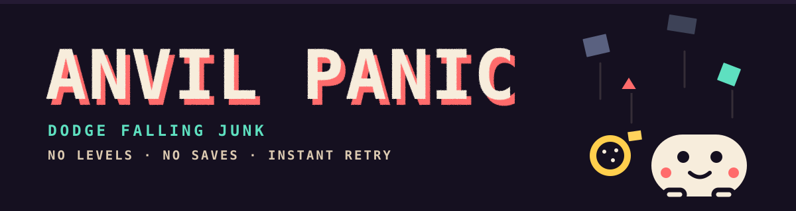

# ANVIL PANIC

**Dodge falling junk. No levels, no saves, instant retry.**

[**Download**](https://github.com/TegsCode/anvil-panic/releases/latest) ·
[**Play in browser**](https://tegscode.github.io/anvil-panic/play/) ·
[**All builds**](https://github.com/TegsCode/anvil-panic/releases) ·
[**Download page**](https://tegscode.github.io/anvil-panic/)

</div>

## Download

Two single files. No installer, no launcher, no folder of assets — the game is
inside the file.

| | Desktop | Android |
|---|---|---|
| **File** | [`AnvilPanicClassic.exe`](https://github.com/TegsCode/anvil-panic/releases/latest/download/AnvilPanicClassic.exe) | [`AnvilPanicClassic.apk`](https://github.com/TegsCode/anvil-panic/releases/latest/download/AnvilPanicClassic.apk) |
| **Size** | ~16 MB | ~240 KB |
| **Runs on** | Windows 10 / 11, 64-bit | Android 8.0+ |
| **Install** | Double-click. That's it. | Tap the file, allow "install unknown apps". |
| **Controls** | Keyboard, or mouse/touch | On-screen buttons, tilt, or touch |

The `.exe` is not code-signed, so Windows will show a "Windows protected your PC"
box the first time. **More info → Run anyway.** The APK is signed with a normal
self-signed key, because it does not ship through Google Play.

iOS: there is no iOS build. The game is HTML and runs in Safari, but Apple has no
way to install a standalone build without an App Store listing or a paid developer
account. [Play it in the browser](https://tegscode.github.io/anvil-panic/play/)
instead — it runs the same code.

## What it is

One screen, one character, one rule: junk falls, you move, the junk wins
eventually. Score is however long you last. There is no progression to unlock and
nothing to grind — you die, you press space, you are playing again in under a
second.

The **classic** build is the version before characters and powers: a single cream
blob, one taunt, no abilities, no voice lines. It is the version that was fun
first, kept exactly as it was.

## Screenshots

| | |
|---|---|
| 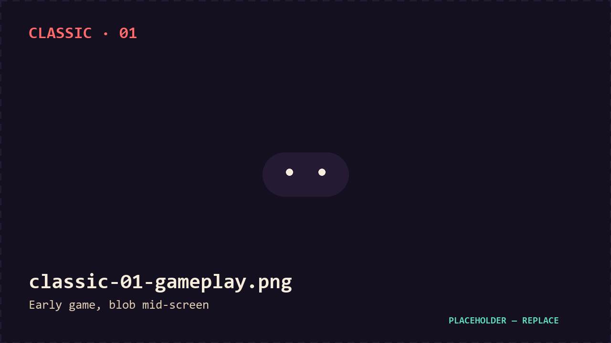 | 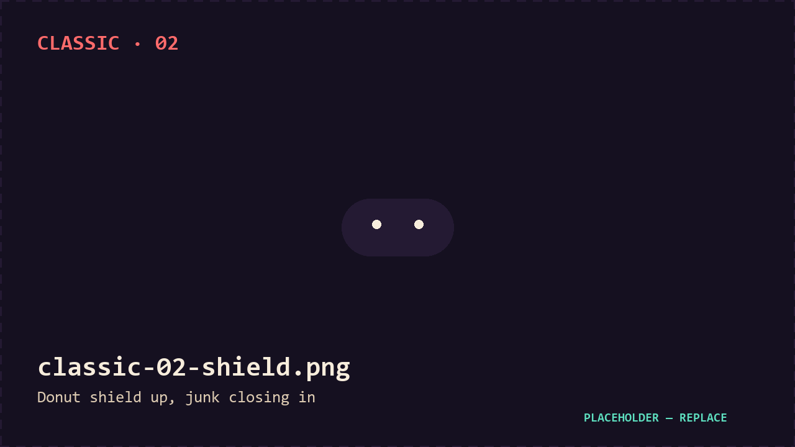 |
| 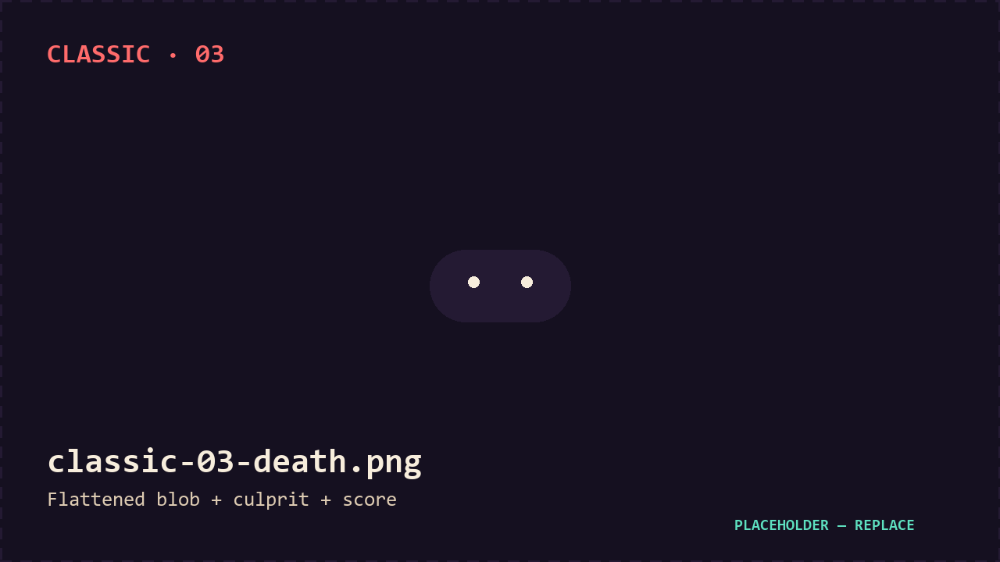 | 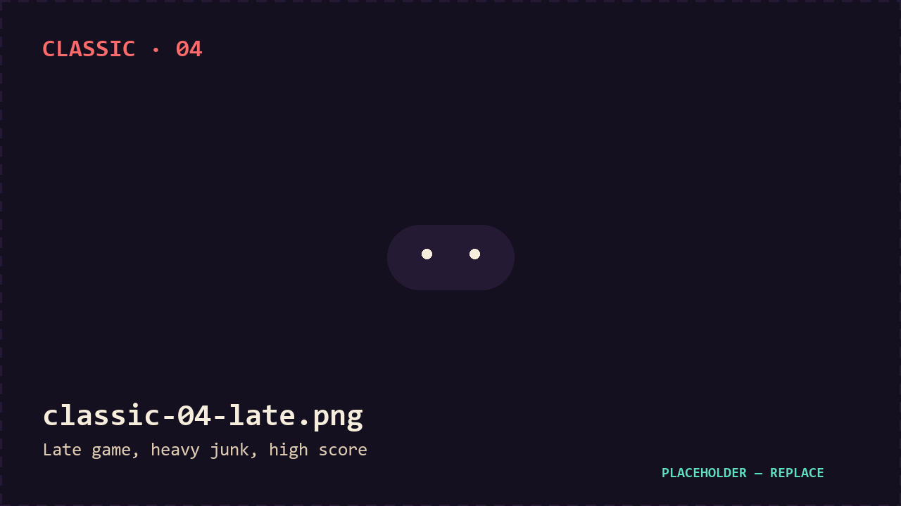 |

## Controls

**Desktop** — `←` `→` or `A` `D` to move · `Shift` to dash · mouse or touch to
steer · `Space` to restart · `M` to mute · `F11` for fullscreen.

**Android** — three ways to move, switchable in the corner:

- **Buttons** — left and right pads, dash in the middle.
- **Tilt** — hold the phone flat-ish and lean; calibration is automatic on start.
- **Touch** — tap and hold to steer there, swipe to drag the character, double-tap
  to dash.

The game is landscape only. Turn the phone sideways.

## ANVIL PANIC 2 is in development

The classic build above is the whole game. The next version is not.

It turns the blob into six characters, each with one passive and one power on a
cooldown — and the junk responds. Screenshots below are from the work in progress;
none of them are in the download yet.

| | | |
|---|---|---|
| 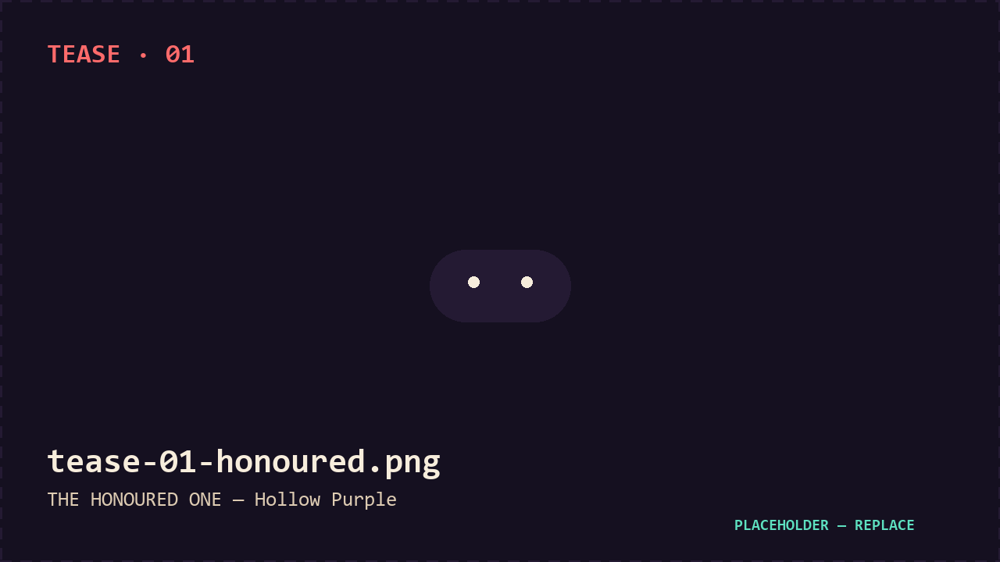 | 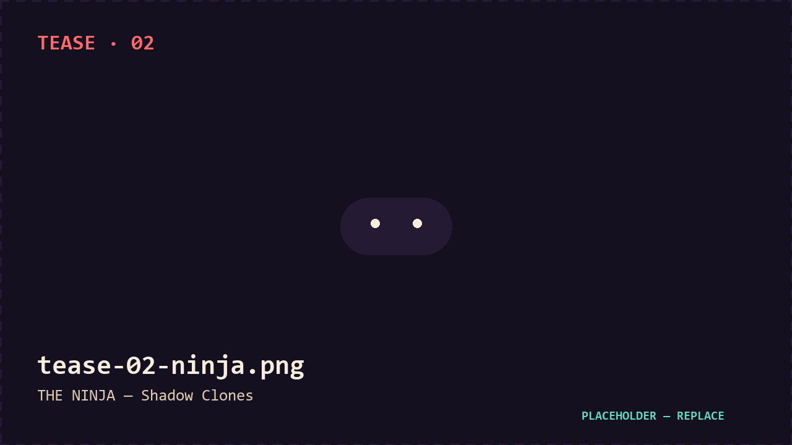 | 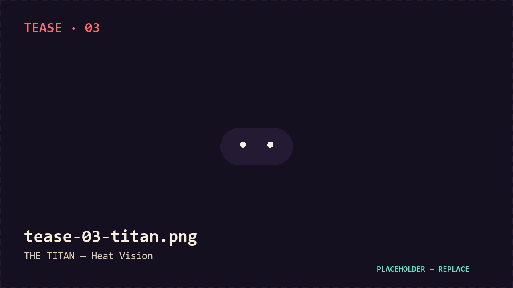 |
| 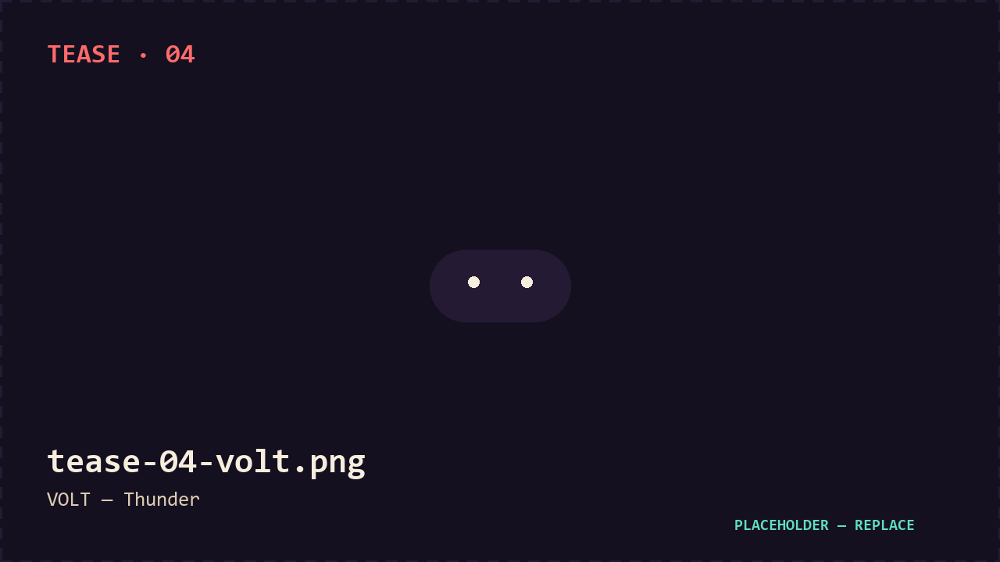 | 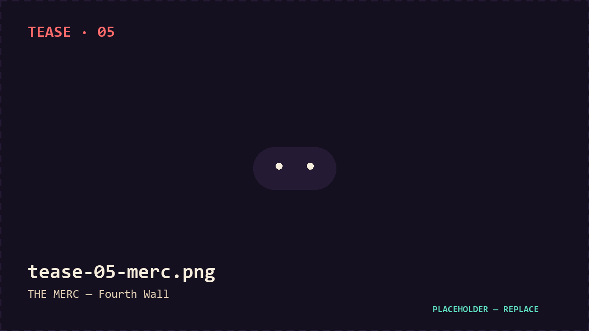 | 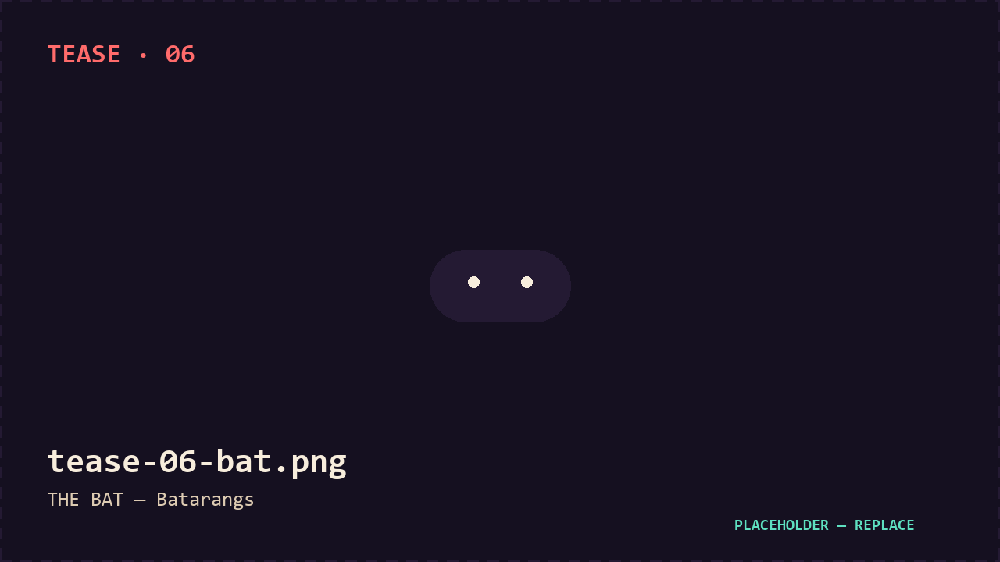 |

**THE HONOURED ONE** — Infinity · *Hollow Purple*
**THE NINJA** — Fast Hands · *Shadow Clones*
**THE TITAN** — Boy Scout · *Heat Vision*
**VOLT** — Static Field · *Thunder*
**THE MERC** — Healing Factor · *Fourth Wall*
**THE BAT** — Prep Time · *Batarangs*

Watch the repo to see it land: ⭐ [TegsCode/anvil-panic](https://github.com/TegsCode/anvil-panic)

## Build it yourself

Everything here is the source that produced the downloads.

```
play/index.html            the whole game — one file, no dependencies, open in a browser
desktop/anvil_panic_app.py window shell used to wrap it as an .exe
desktop/build-classic.bat  rebuilds AnvilPanicClassic.exe (PyInstaller one-file)
android/                   WebView wrapper + the Gradle project that makes the .apk
assets/                    banner and screenshots
index.html                 the download page served by GitHub Pages
```

Desktop:

```bat
pip install pyinstaller pywebview
desktop\build-classic.bat
```

Android (needs a JDK 17 and the Android SDK; `android/bootstrap-toolchain.ps1`
installs both to `F:\dev` on Windows):

```bat
cd android
gradlew.bat assembleRelease
```

Browser: just open `play/index.html`. No server, no build step.

## License

Source-available, **not** open source in the "do what you like" sense. Read it,
run it, change it for yourself, share it non-commercially. You may not sell it or
ship a modified build commercially. See [LICENSE](LICENSE).

The name and the character are mine. Please don't publish your own build of it.
